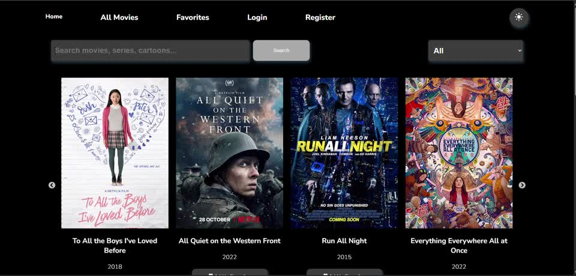
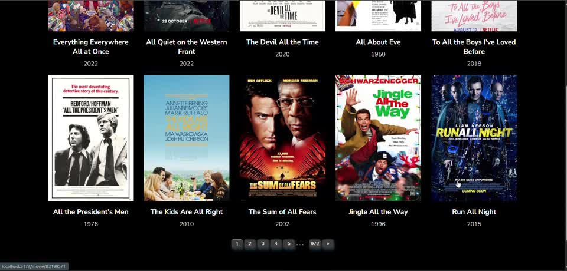
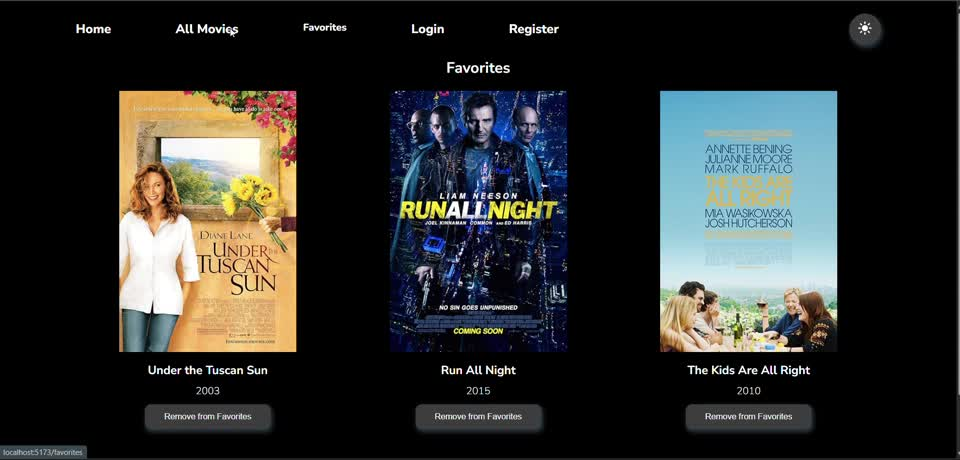
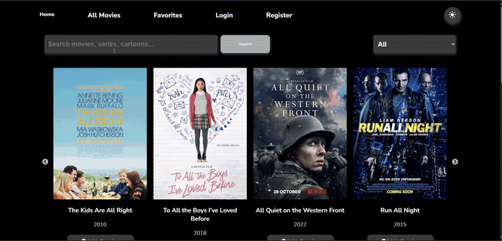

# 🎬 Movie Explorer

A movie discovery web application built with **React**. Browse a movie collection, search for titles, view movie details, and organize your favorites.

## 📸 Screenshots

### Home page


### Movie catalog


### Favorites


## 🎥 Demo Video



[▶ Watch the Movie Explorer demo](demo/movie-explorer-demo.mp4)

> Click the link to open the video file on GitHub. Depending on your browser, it may open or download.

## ✨ Features

- Search for movies
- Browse movie collections and navigate pages
- View movie details
- Add movies to favorites
- Login and registration pages
- Light and dark theme

## 🛠 Technologies

- React
- JavaScript
- Vite
- React Router
- SCSS

## 🚀 Getting Started

Clone the repository:

```bash
git clone https://github.com/marinenok2/movie-explorer.git
cd movie-explorer
```

Install dependencies:

```bash
npm install
```

Start the development server:

```bash
npm run dev
```

Open the local URL printed in the terminal (usually `http://localhost:5173`).

## 👩‍💻 Author

**Maryna Khvoinytska** — [GitHub](https://github.com/marinenok2)
